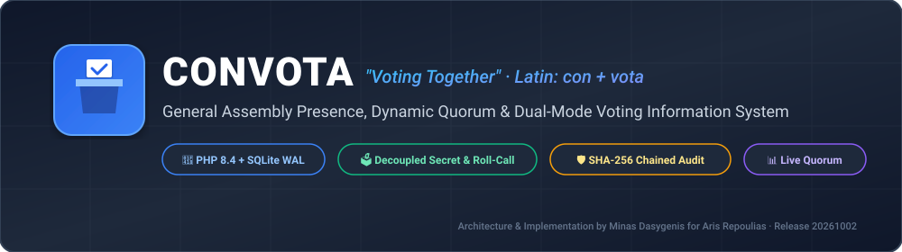
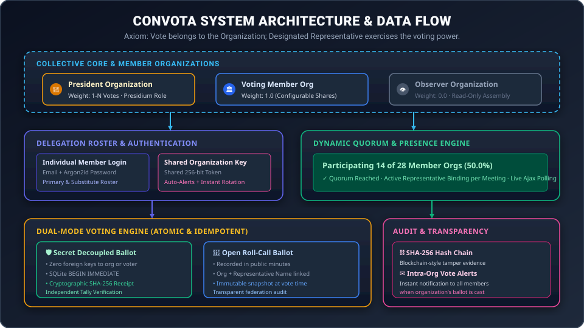
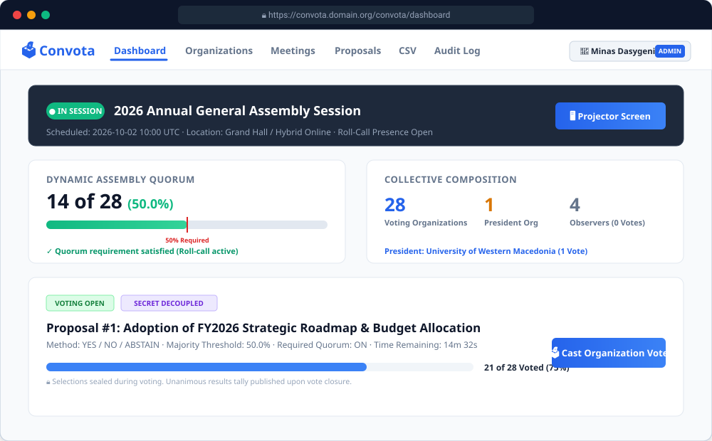
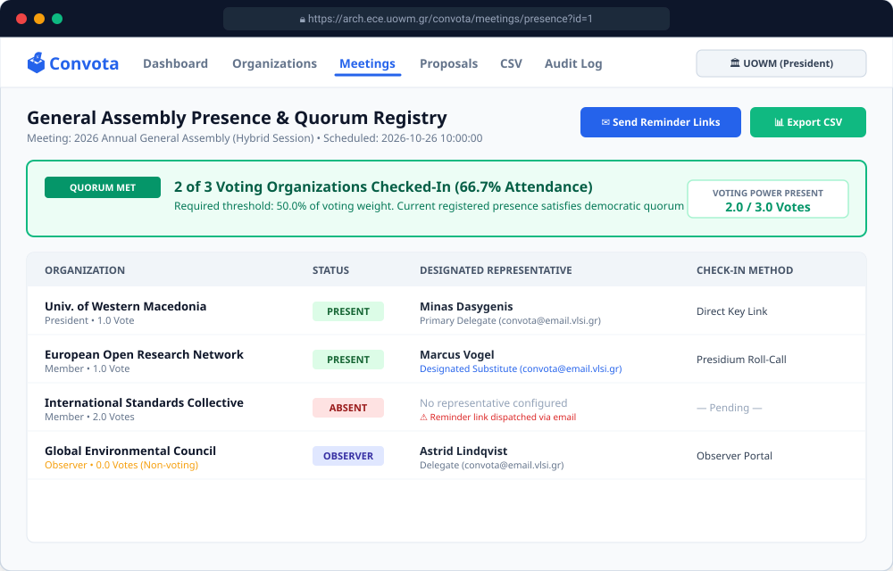
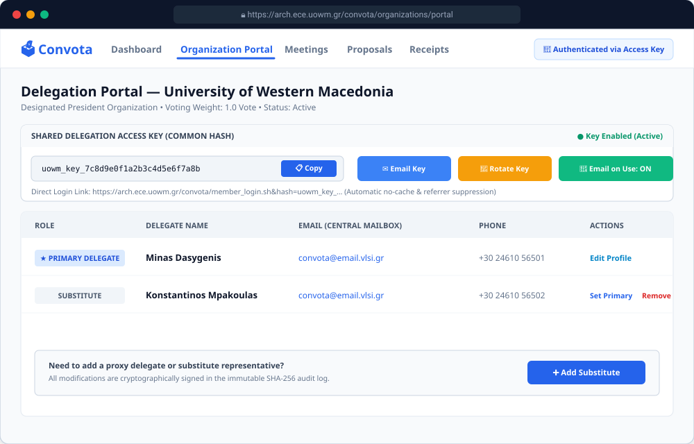
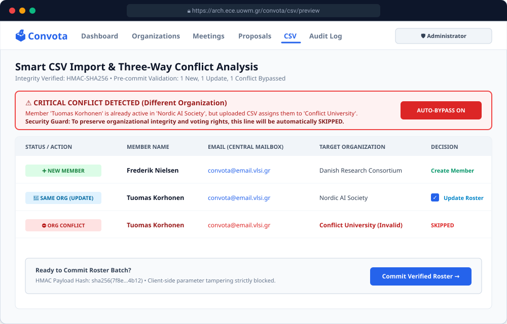
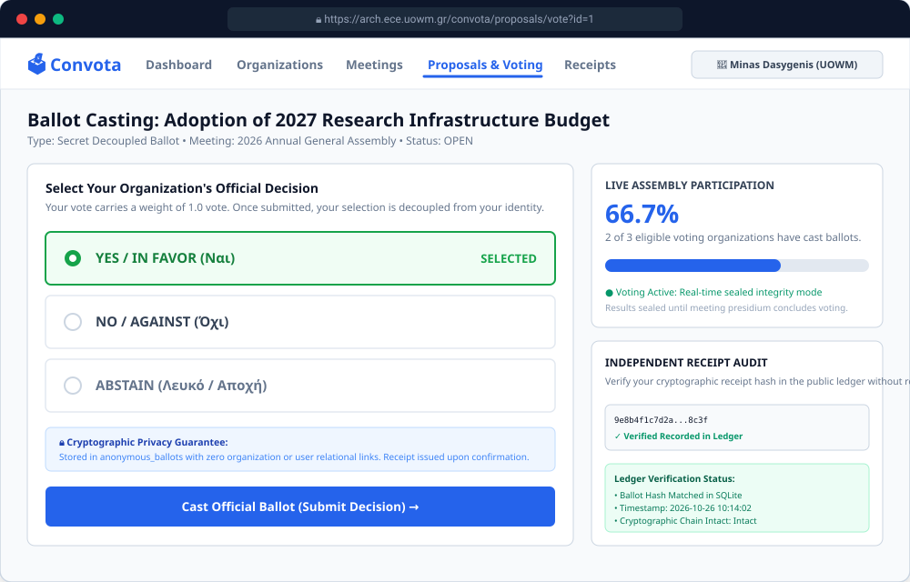
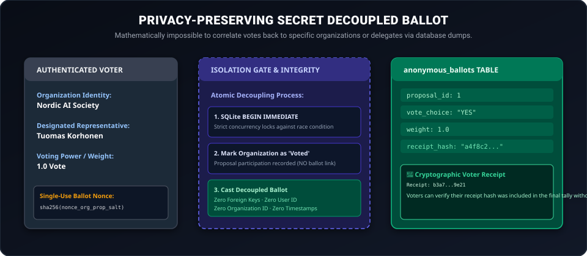
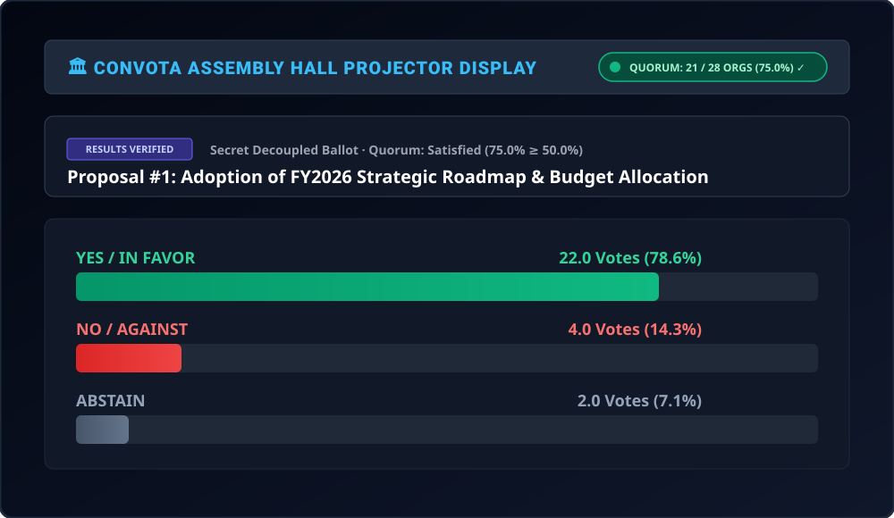

# Convota (Voting Together) — Ελληνική Τεκμηρίωση

<p align="center">
  
</p>

Το **Convota** (*"Voting Together"*, από το λατινικό *con* + *vota*) είναι ένα ανοιχτό, ασφαλές και προσανατολισμένο στην προστασία της ιδιωτικότητας Πληροφοριακό Σύστημα Παρουσιών και Ψηφοφοριών Γενικών Συνελεύσεων, αναπτυγμένο με **native PHP 8.4** και **SQLite3 (σε λειτουργία WAL)** χωρίς καμία εξάρτηση από εξωτερικά frameworks ή third-party πακέτα.

Σχεδιασμένο για διεθνείς ερευνητικές κοινοπραξίες, πανεπιστημιακές γενικές συνελεύσεις, συγκλήτους, ομοσπονδίες, οργανισμούς προτυποποίησης, συνεταιρισμούς και μη κυβερνητικές οργανώσεις (ΜΚΟ).

> **Θεμελιώδες Αξίωμα:** *Η ψήφος ανήκει στον οργανισμό/μέλος. Ο ορισμένος εκπρόσωπος είναι το πιστοποιημένο φυσικό πρόσωπο που ασκεί το δικαίωμα ψήφου του οργανισμού αυτού.*

---

## Οπτική Έκθεση Διεπαφών & Αρχιτεκτονική (Visual Showcase)

### 1. Αρχιτεκτονική Συστήματος & Ροή Δεδομένων
<p align="center">
  
</p>

### 2. Ζωντανός Πίνακας Ελέγχου Γενικής Συνέλευσης (Dashboard)
<p align="center">
  
</p>

### 3. Μητρώο Παρουσιών & Ονομαστικού Ελέγχου Συνέλευσης
<p align="center">
  
</p>

### 4. Πύλη Αντιπροσωπείας Οργανισμού & Διαχείριση Κοινόχρηστου Κλειδιού
<p align="center">
  
</p>

### 5. Έξυπνη Εισαγωγή CSV & Ανάλυση Συγκρούσεων 3 Επιπέδων
<p align="center">
  
</p>

### 6. Ζωντανό Ψηφοδέλτιο & Κρυπτογραφική Επαλήθευση Απόδειξης
<p align="center">
  
</p>

### 7. Αρχιτεκτονική Μυστικής Αποσυνδεδεμένης Ψηφοφορίας
<p align="center">
  
</p>

### 8. Λειτουργία Προβολέα Μεγάλης Οθόνης Αίθουσας Συνελεύσεων
<p align="center">
  
</p>

---

## Κύρια Χαρακτηριστικά

1. **Μοντέλο Συλλογικότητας & Οργανισμών:**
   - Ενιαία εγκατάσταση συλλογικότητας που διαχειρίζεται πολλαπλούς οργανισμούς-μέλη.
   - Παραμετροποιήσιμα βάρη ψήφου (προεπιλογή 1 ψήφος, κλασματικά/σταθμισμένα μερίδια, ή 0 ψήφοι για Παρατηρητές).
   - Δυναμικός ορισμός **Προεδρεύοντος Οργανισμού** (με δυνατότητα επαναπροσδιορισμού από τον Διαχειριστή).
   - Δημόσιο μητρώο συνέλευσης με μορφή: `[Οργανισμός] — [Βάρος Ψήφου] — [Ορισμένος Εκπρόσωπος]`.

2. **Μητρώο Αντιπροσωπείας & Κοινόχρηστα Κλειδιά Πρόσβασης:**
   - Τακτικοί (πρωτεύοντες) εκπρόσωποι και αναπληρωματικά μέλη.
   - Κάθε μέλος ή διαχειριστής μπορεί να προσθέσει/αφαιρέσει αναπληρωτές.
   - **Κοινόχρηστο Κλειδί Πρόσβασης Οργανισμού (Shared Hash):** Μοναδικό κοινόχρηστο διακριτικό ανά οργανισμό με λεπτομερείς ρυθμίσεις ασφαλείας (αποστολή κλειδιού στα μέλη μέσω email, επανεκκίνηση/περιστροφή κλειδιού, ενεργοποίηση/απενεργοποίηση, ειδοποιήσεις email κατά τη χρήση).
   - Ιστορική λογοδοσία: Όλες οι προσθήκες και διαγραφές μελών καταγράφουν δράστη, στόχο, διεύθυνση IP πελάτη και χρονοσήμανση σε κρυπτογραφικό αρχείο καταγραφής ελέγχου (audit trail).

3. **Παρουσίες & Δυναμική Απαρτία σε Πραγματικό Χρόνο:**
   - Ορισμός ενεργού εκπροσώπου ανά συνεδρίαση (μέσω εισόδου μέλους, κοινόχρηστου κλειδιού, ή ονομαστικού ελέγχου προεδρείου).
   - Παρακολούθηση δυναμικής απαρτίας (π.χ. `Συμμετέχουν 14 από 28 οργανισμούς με δικαίωμα ψήφου (50.0% παρουσία)`).
   - Αυτόματη ανανέωση οθόνης παρουσιών μέσω AJAX/Fetch polling.
   - **Υπενθυμίσεις Παρουσίας Προεδρείου:** Ο Πρόεδρος ή ο Διαχειριστής μπορεί να αποστείλει συνδέσμους υπενθύμισης (με αυτόματα ανιχνευόμενες απόλυτες διευθύνσεις URL και απευθείας κλειδιά ανάθεσης) σε όλα τα μέλη των μη διαμορφωμένων οργανισμών.
   - Εξαγωγή παρουσιών σε αρχείο CSV.

4. **Μηχανή Ψηφοφορίας Διπλής Λειτουργίας:**
   - **Μυστικό Αποσυνδεδεμένο Ψηφοδέλτιο:** Ο πίνακας `anonymous_ballots` διαθέτει **μηδενική σχεσιακή σύνδεση ή ξένα κλειδιά** προς ψηφοφόρους ή οργανισμούς. Οι ψηφοφόροι λαμβάνουν κρυπτογραφική απόδειξη καταχώρισης (SHA-256 receipt hash) για ανεξάρτητη επαλήθευση καταμέτρησης.
   - **Φανερή Ονομαστική Ψηφοφορία:** Καταγράφει οργανισμό και ονοματεπώνυμο εκπροσώπου στα δημόσια πρακτικά.
   - **Προστασία Anti-Replay & Idempotent API:** SQLite `BEGIN IMMEDIATE TRANSACTION`, μοναδικοί περιορισμοί (unique constraints) και nonces μίας χρήσης αποτρέπουν διπλοψηφίες και επιθέσεις επανάληψης.
   - **Ντετερμινιστική Μηχανή Καταστάσεων:** `DRAFT` $\rightarrow$ `OPEN` $\rightleftharpoons$ `PAUSED` $\rightarrow$ `CLOSED` $\rightarrow$ `ARCHIVED`.
   - **Σφραγισμένα Αποτελέσματα:** Οι επιλογές ψήφου αποκρύπτονται αυστηρά κατά τη διάρκεια της ψηφοφορίας. Τα μαθηματικά αθροίσματα και ποσοστά αποκαλύπτονται μόνο μετά το κλείσιμο της ψηφοφορίας.
   - **Εσωτερική Διαφάνεια Οργανισμού:** Αυτόματη ειδοποίηση μέσω email σε όλα τα μέλη ενός οργανισμού μόλις κατατεθεί η ψήφος του.
   - **Λειτουργία Προβολέα Αίθουσας Συνελεύσεων:** Πλήρης οθόνη, υψηλής αντίθεσης θέμα προβολής για οθόνες αιθουσών συνεδριάσεων.

5. **Έξυπνη Εισαγωγή CSV με Ανίχνευση Συγκρούσεων:**
   - Μορφή: `A/a, name, surname, email, organization, [telephone], [vote_weight]`
   - Οπτική μηχανή συγκρούσεων: Εντοπίζει υπάρχοντα email εγγεγραμμένα σε *διαφορετικό οργανισμό* με **έντονη κόκκινη προειδοποίηση** και τα παρακάμπτει αυτόματα.
   - Επιτρέπει επιλεκτική ενημέρωση υπαρχόντων μελών στον *ίδιο οργανισμό* μέσω πλαισίου επιλογής.
   - Κρυπτογραφική ακεραιότητα προ-υποβολής: Υπογραφή δεδομένων φόρμας με HMAC-SHA256 για αποτροπή αλλοίωσης παραμέτρων από την πλευρά του πελάτη.

6. **Πολυεπίπεδη Ασφάλεια & Θωράκιση OWASP Top 10:**
   - Λειτουργία SQLite WAL (`PRAGMA journal_mode = WAL;`, `foreign_keys = ON;`, `busy_timeout = 5000;`).
   - Κανονική ανακατεύθυνση HTTPS και HSTS.
   - Αυστηρή επίλυση ταυτότητας ψηφοφόρου αποκλειστικά από τη συνεδρία διακομιστή (εξάλειψη ευπαθειών IDOR).
   - Πολιτική Ασφάλειας Περιεχομένου βασισμένη σε Nonce (`script-src 'self' 'nonce-...'`).
   - Αυστηρά ελεγχόμενη πολιτική CORS σε διαδρομές API (`arch.ece.uowm.gr`, `uowm.gr`, `localhost`).
   - Αυτόματη απόκρυψη (redaction) διακριτικών και κλειδιών από τα αρχεία καταγραφής (`data/mail.log`).
   - Προστασία από επιθέσεις Open Redirect στις εσωτερικές ανακατευθύνσεις.
   - Περιορισμός ρυθμού αιτημάτων (rate limiting) με βάση τη βάση SQLite για εισόδους κωδικού και κοινόχρηστων κλειδιών.
   - Κατακερματισμός κωδικών με Argon2id, ασφαλής διαχείριση συνεδρίας (`HttpOnly`, `SameSite=Strict`, `Secure`).
   - Προστασία CSRF σε όλες τις μεταλλάξεις καταστάσεων (διακριτικό φόρμας και κεφαλίδα `X-CSRF-Token`).
   - Απαραβίαστο αρχείο καταγραφής ελέγχου (audit trail) με αλυσίδα κατακερματισμού SHA-256.

---

## Γρήγορη Εκκίνηση & Τοπική Εκτέλεση

### 1. Εκκίνηση Ενσωματωμένου Διακομιστή Web
```bash
cd /projects/convota
php -S 0.0.0.0:8000 -t public/
```
Στη συνέχεια πλοηγηθείτε στο: `http://localhost:8000` (ή `https://` εάν βρίσκεται πίσω από reverse proxy).

### 2. Προεπιλεγμένα Στοιχεία Σύνδεσης (Seeded Credentials)

> [!IMPORTANT]
> **Κανόνας Κεντρικού Γραμματοκιβωτίου Δοκιμών:**
> Το ΜΟΝΑΔΙΚΟ email που επιτρέπεται να χρησιμοποιείται για δοκιμές, αυτοματοποιημένους ελέγχους, δοκιμαστικούς εκπροσώπους και εικονικά δεδομένα είναι το **`convota@email.vlsi.gr`** (με το **`adminconvota@email.vlsi.gr`** να διατηρείται αποκλειστικά για τον υπερ-διαχειριστή).
> Απαγορεύεται αυστηρά η χρήση ψεύτικων εξωτερικών domains (όπως `@example.com` ή τυχαίων διευθύνσεων) καθώς προκαλούν απόρριψη από τον διακομιστή αλληλογραφίας (`554 5.7.1 Lazy spammer sending to obviously bogus addresses`).

#### Υπερ-Διαχειριστής (Super Administrator):
- **Email:** `adminconvota@email.vlsi.gr`
- **Κωδικός:** `AdminConvota2026!` (παραμετροποιήσιμος μέσω της μεταβλητής περιβάλλοντος `CONVOTA_ADMIN_PASSWORD`)

#### Ενδεικτικοί Οργανισμοί-Μέλη:
- **Πανεπιστήμιο Δυτικής Μακεδονίας (UOWM)** (Προεδρεύων Οργανισμός, 1 Ψήφος)
  - Τακτικός Εκπρόσωπος: `convota@email.vlsi.gr` (Μηνάς Δασυγένης) / `MemberPassword2026!`
  - Αναπληρωτής: `convota@email.vlsi.gr` (Κωνσταντίνος Μπακούλας)
- **European Open Research Network (EORN)** (1 Ψήφος)
  - Τακτικός Εκπρόσωπος: `convota@email.vlsi.gr` (Elena Rostova) / `MemberPassword2026!`
  - Αναπληρωτής: `convota@email.vlsi.gr` (Marcus Vogel)
- **International Standards Collective (ISC)** (2 Ψήφοι)
  - Τακτικός Εκπρόσωπος: `convota@email.vlsi.gr` (Sophie Dubois) / `MemberPassword2026!`
- **Global Environmental Council (GEC)** (Παρατηρητής, 0 Ψήφοι)
  - Εκπρόσωπος: `convota@email.vlsi.gr` (Astrid Lindqvist) / `MemberPassword2026!`

---

## Ανάπτυξη & Φορητότητα Διαδρομών

Το Convota είναι πλήρως φορητό και λειτουργεί άμεσα σε δύο διακριτές τοπολογίες χωρίς χειροκίνητες τροποποιήσεις κώδικα:

1. **Λειτουργία Υποφακέλου / Υποδιαδρομής** (π.χ. `https://arch.ece.uowm.gr/convota/`):
   - Πλήρης υποστήριξη μέσω frontend reverse proxy ή τοπικού Nginx alias.
   - Η εφαρμογή ανιχνεύει αυτόματα το `/convota` ως βασική διαδρομή μέσω της `App::detectBasePath()`, της `$_SERVER['REQUEST_URI']`, ή της κεφαλίδας `X-Forwarded-Prefix`.
   - Όλοι οι εσωτερικοί σύνδεσμοι, στυλ, scripts, φόρμες και κλήσεις AJAX API δημιουργούνται μέσω της συνάρτησης `url('/relative-path')`.
2. **Λειτουργία Ρίζας / Υποτομέα** (π.χ. `http://convota.domain.com/` ή `http://localhost:8000/`):
   - Λειτουργεί απρόσκοπτα στη ρίζα εγγράφων με κενή βασική διαδρομή (`""`).

### Ρύθμιση Frontend Nginx Reverse Proxy (`convota.conf`)

Για δημόσια διάθεση πίσω από εμπρόσθιο reverse proxy Nginx, χρησιμοποιήστε το παρεχόμενο αρχείο [`convota.conf`](file:///projects/convota/convota.conf):

```bash
# Αντιγραφή στον κατάλογο τοποθεσιών του frontend Nginx:
# FreeBSD:
cp convota.conf /usr/local/etc/nginx/locations/convota.conf
# Linux:
cp convota.conf /etc/nginx/locations/convota.conf

# Έλεγχος σύνταξης και επαναφόρτωση Nginx:
nginx -t && nginx -s reload
```

---

## Αυτοματοποιημένη Σουίτα Ελέγχων (Automated Test Suite)

Το Convota περιλαμβάνει ολοκληρωμένη σουίτα αυτοματοποιημένων ελέγχων που καλύπτει και τις 7 φάσεις ανάπτυξης (175 αυτοματοποιημένοι έλεγχοι):

```bash
php /projects/convota/tests/run_all_tests.php
```

Επιμέρους σουίτες δοκιμών:
- `php tests/test_phase1.php` — Λειτουργία WAL βάσης δεδομένων, Migrations, Seeder, Αλυσίδα κατακερματισμού Audit, Αυθεντικοποίηση, CSRF (31 έλεγχοι)
- `php tests/test_phase2.php` — Οργανισμοί, Μητρώο Μελών, Μηχανή Συγκρούσεων CSV, Εξαγωγές CSV (39 έλεγχοι)
- `php tests/test_phase3.php` — Συνεδριάσεις, Παρακολούθηση Παρουσιών, Ορισμός Εκπροσώπου, Δυναμική Απαρτία (27 έλεγχοι)
- `php tests/test_phase4.php` — Μηχανή Ψηφοφορίας, Μυστικά Αποσυνδεδεμένα Ψηφοδέλτια, Idempotency, Anti-Replay, Ειδοποιήσεις (27 έλεγχοι)
- `php tests/test_phase5.php` — REST APIs (`/api/quorum`, `/api/voting-status`, `/api/vote`), Διανομέας Web, Κεφαλίδες Ασφαλείας (12 έλεγχοι)
- `php tests/test_nginx_routing.php` — Φορητότητα Υποδιαδρομών & Υποτομέων, Αυτόματη Ανίχνευση Base Path, Βοηθοί URL (16 έλεγχοι)
- `php tests/test_security_fixes.php` — Θωράκιση OWASP Top 10, Προστασία IDOR Ψηφοφορίας, Open Redirect, HMAC, Rate Limiting, Redaction (23 έλεγχοι)

---

## Εγχειρίδια Χρήσης & Τεκμηρίωση

Αναλυτικά εγχειρίδια χρήσης και οδηγίες διαχείρισης βρίσκονται στον κατάλογο [`documentation/`](file:///projects/convota/documentation):

* 📘 **[Οδηγός Διαχειριστή & Προεδρείου](file:///projects/convota/documentation/ADMINISTRATOR_GUIDE.md):** Πλήρες εγχειρίδιο για διαχειριστές και μέλη προεδρείου που καλύπτει τη διαμόρφωση της συλλογικότητας, τη διαχείριση μητρώου, την περιστροφή κοινόχρηστων κλειδιών, έξυπνες εισαγωγές/εξαγωγές CSV, δυναμικό υπολογισμό απαρτίας, υπενθυμίσεις παρουσίας, μυστικές/φανερές ψηφοφορίες και κρυπτογραφικό έλεγχο αρχείου καταγραφής.
* 📗 **[Οδηγός Μέλους & Εκπροσώπου](file:///projects/convota/documentation/MEMBER_GUIDE.md):** Οδηγίες βήμα-προς-βήμα για εκπροσώπους οργανισμών που καλύπτουν προσωπική σύνδεση, συνδέσμους κοινόχρηστου κλειδιού, δήλωση παρουσίας σε συνεδριάσεις, ορισμό ενεργού ψηφοφόρου, διεξαγωγή μυστικής ψηφοφορίας, αποθήκευση αποδείξεων και δημόσια επαλήθευση απόδειξης.
* 🛡️ **[Έκθεση Ελέγχου Ασφαλείας OWASP](file:///root/SECURITY_AUDIT_convota.md):** Πλήρης αναφορά αποκατάστασης των 13 ευπαθειών ασφαλείας.

---

## Δομή Αρχείων Έργου

```
/projects/convota/
├── .gitignore
├── CHANGELOG.md               <-- Αναλυτικό ημερολόγιο εκδόσεων και φάσεων
├── README.md                  <-- Επισκόπηση έργου και γρήγορη εκκίνηση (Αγγλικά)
├── README-GR.md               <-- Επισκόπηση έργου και γρήγορη εκκίνηση (Ελληνικά)
├── SPECIFICATIONS.md          <-- Πλήρεις τεχνικές προδιαγραφές και προδιαγραφές ασφαλείας
├── AGENTS.md                  <-- Κανόνες αυτόνομων πρακτόρων & πρωτόκολλα δοκιμών
├── convota.conf               <-- Ρύθμιση παραμέτρων frontend reverse proxy Nginx
├── docs/                      <-- Διαγράμματα αρχιτεκτονικής και γραφικά στοιχεία
│   └── images/                <-- Διανυσματική έκθεση διεπαφών (SVG showcase gallery)
├── documentation/             <-- Αναλυτικά εγχειρίδια χρήσης και διαχείρισης
│   ├── ADMINISTRATOR_GUIDE.md <-- Αναλυτικός οδηγός διαχειριστών συστήματος & προεδρείου
│   └── MEMBER_GUIDE.md        <-- Οδηγός βήμα-προς-βήμα για εκπροσώπους και ψηφοφόρους
├── config/
│   └── config.php             <-- Σταθερές εφαρμογής, ρυθμίσεις ηλεκτρονικού ταχυδρομείου & ασφάλειας
├── data/
│   ├── .htaccess              <-- Αποκλεισμός άμεσης πρόσβασης από τον ιστό
│   ├── convota.sqlite         <-- Βάση δεδομένων SQLite παραγωγής (WAL mode)
│   └── mail.log               <-- Αρχείο καταγραφής ειδοποιήσεων με απόκρυψη διακριτικών
├── public/
│   ├── .htaccess              <-- Κεφαλίδες ασφαλείας, επανεγγραφή URL, ανακατεύθυνση HTTPS
│   ├── index.php              <-- Σημείο εισόδου front controller
│   └── assets/
│       ├── css/
│       │   ├── app.css        <-- Σύγχρονο responsive σύστημα σχεδίασης
│       │   └── projector.css  <-- Θέμα υψηλής αντίθεσης για προβολείς αιθουσών
│       └── js/
│           ├── app.js         <-- Ζωντανό polling, εργαλεία αντιγραφής, ενσωμάτωση CSRF
│           └── projector.js   <-- Ρολόι πλήρους οθόνης & ζωντανός συγχρονισμός
├── src/
│   ├── App.php                <-- Container εφαρμογής, δρομολογητής & middleware
│   ├── Autoload.php           <-- Αυτόματος φορτωτής κλάσεων PSR-4
│   ├── Auth/
│   │   ├── AuthService.php    <-- Κωδικοί πρόσβασης Argon2id, συνεδρίες, lockout, reset tokens
│   │   └── HashAuth.php       <-- Διαχειριστής κοινόχρηστων κλειδιών οργανισμών & rate limiting
│   ├── Controllers/           <-- Ελεγκτές διαδρομών και ενεργειών
│   ├── Database/              <-- Διαχείριση βάσης δεδομένων, migrations & seeders
│   ├── Models/                <-- Μοντέλα δεδομένων συλλογικότητας
│   ├── Security/              <-- Μονάδες ασφαλείας CSRF, κεφαλίδων & επικύρωσης εισόδου
│   ├── Services/              <-- Επιχειρησιακή λογική, ψηφοφορία, απαρτία, CSV & mailer
│   └── Views/                 <-- Σημασιολογικές όψεις HTML με διαφυγή UTF-8
└── tests/
    ├── run_all_tests.php      <-- Κεντρικός εκτελεστής δοκιμών (175 έλεγχοι σε 7 φάσεις)
    ├── test_phase1.php
    ├── test_phase2.php
    ├── test_phase3.php
    ├── test_phase4.php
    ├── test_phase5.php
    ├── test_nginx_routing.php
    └── test_security_fixes.php
```
