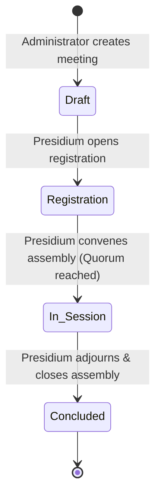
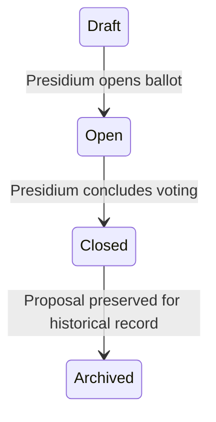

# Convota — Administrator & Presidium Guide

Welcome to the **Convota Administrator & Presidium Guide**. This guide provides complete documentation for managing a Convota installation, administering member organizations, conducting General Assembly meetings, monitoring real-time dynamic quorum, overseeing cryptographic voting sessions, and maintaining the tamper-evident audit trail.

---

## 1. System Overview & Architecture

**Convota** (*"Voting Together"*, Latin *con* + *vota*) is a secure web-based information and decision-making system designed for General Assembly presence verification, dynamic quorum calculation, and cryptographic voting in member-driven collectives, federations, associations, research networks, and NGOs.

### Core Axioms
* **Organizational Sovereignty:** The vote belongs to the member organization, not to an individual person.
* **Delegation Flexibility:** The designated representative is the authenticated individual authorized to exercise that organization's presence and voting rights for a given session.
* **Accountability & Separation:** Privacy in secret balloting is decoupled at the database storage level from attendance verification, while remaining 100% auditable via cryptographic receipts.

### System Architecture
* **Backend:** PHP 8.4 (native, strict types, zero external heavy dependencies)
* **Storage:** SQLite3 with Write-Ahead Logging (`WAL` mode) and busy timeout locking
* **Web Server & Reverse Proxy:** Dual deployment support—runs seamlessly in a subpath (e.g. `/convota/`) behind an Nginx reverse proxy or on a root domain (e.g. `https://convota.domain.org/`).
* **Mail Dispatch:** Postfix / MTA integration via PHP `mail()` with UTF-8 envelope sender handling and delivery status tracking.

---

## 2. Administrator Credentials & Initial Login

### Default Credentials
Upon initial deployment and database seeding:
* **Administrator Email:** `adminconvota@email.vlsi.gr`
* **Default Password:** `AdminConvota2026!` (Administrators should change this password immediately upon first login)

### Accessing the Administrative Interface
1. Navigate to the login page: `https://<your-domain>/convota/login`
2. Enter your administrator email and password.
3. Upon authentication, you will be redirected to the **Assembly Dashboard** (`/convota/dashboard`).

---

## 3. Organization Management

An assembly collective is comprised of member organizations. The administrator maintains the collective's organization directory.

### 3.1 Adding an Organization
1. From the navigation bar, navigate to **Organizations** -> click **+ New Organization** (`/convota/organizations/create`).
2. **Fundamental Fields (Required):**
   * **Organization Name:** Official entity name (e.g., *University of Western Macedonia*).
   * **Voting Weight:** Number of votes allocated (default is `1.0`). Set to `0` for Observer organizations.
   * **First Member Delegation Details:**
     * First Name & Surname
     * Email address (must be valid; welcome password setup instructions will be sent here)
     * Optional Telephone Number
3. **Optional Managerial Metadata:**
   * Short Name / Acronym (e.g., *UOWM*)
   * Country
   * Official Website URL
   * Description / Scope
4. **Observer Organization Setting:**
   * Checking "Observer Organization" sets the voting weight to 0. Observers may register presence and view assembly proceedings, but cannot cast ballots or affect voting quorums.
5. Click **Create Organization**. The system automatically:
   * Inserts the organization record.
   * Generates a unique 64-character SHA-256 **Shared Organization Access Key** (`common_hash`).
   * Registers the first member as the **Primary Delegate**.
   * Dispatches an onboarding email to the member with an absolute link to configure their account password.
   * Cryptographically logs the event into `audit_logs`.

### 3.2 Overriding Voting Weights & President Organization
* **Voting Weight Override:** While the default is 1 vote per member organization, administrators can edit any organization to assign custom weights (e.g., `2.0` for a founding partner or tiered consortium member).
* **President Organization:** Exactly one organization holds the presidential designation at any given time.
  * To change the president, open **Organizations** (`/convota/organizations`), find the desired entity, and click **Set President**.
  * The primary delegate of the chosen organization automatically receives Presidium administrative oversight privileges.

---

## 4. Delegation Roster & Shared Access Keys

Each member organization can have multiple registered delegates: one **Primary Delegate** and one or more **Substitute Delegates**.

### 4.1 Delegation Management in Edit View (`/convota/organizations/edit`)
Administrators can directly manage an organization's delegation roster:
* **Add Member:** Fill out the member form (First Name, Surname, Email, Phone) and click *Add Member*.
* **Edit Member:** Click *Edit* on any member row to open an in-place modal to update name, surname, or telephone number.
* **Set Primary Delegate:** Click *Set Primary* on any substitute member. That delegate is immediately designated as the Primary, and all other members are automatically reorganized as Substitutes.
* **Remove Member:** Remove a delegate from the organization. If a primary delegate is removed and substitutes exist, the longest-standing substitute is automatically promoted to primary.

### 4.2 Shared Organization Access Key (Common Hash)
Every organization has a unique 64-character alphanumeric access key. This key acts as an organizational credential that can be shared among authorized delegation members.

* **Direct Access Link:**
  Delegates can log in without typing credentials using the dynamically discovered direct URL:
  ```text
  https://<domain>/convota/member_login.sh&hash=<organization_common_hash>
  ```
* **Security Controls in the Organization Portal:**
  * **Notify all members by email on login via key (ON/OFF):** When enabled, every registered member of the organization receives an immediate security alert email whenever the shared key is used to authenticate.
  * **Email Access Key to Members:** Sends the active key and direct login link to all registered members.
  * **Rotate & Reinitialize Key:** Revokes the current key and generates a fresh one, immediately emailing the new key to all delegation members.
  * **Enable/Disable Key Authorization:** Allows completely disabling key login, enforcing individual email and password login only.

---

## 5. CSV Bulk Roster Management

Convota provides enterprise-grade CSV tools for importing and exporting organizations and members.

### 5.1 Smart CSV Import (`/convota/csv/import`)
Convota's CSV engine features a two-phase verification process (Preview -> Commit) with intelligent duplicate detection:
1. **Prepare CSV File:**
   ```csv
   Organization Name,Short Name,Country,Website,Voting Weight,Is Observer,Member Name,Member Surname,Member Email,Member Telephone,Is Primary
   University of Western Macedonia,UOWM,Greece,https://www.uowm.gr,1.0,0,Minas,Dasygenis,convota@email.vlsi.gr,+302461056500,1
   ```
2. **Phase 1: Preview & Validation:**
   * Convota parses the uploaded CSV and checks every row against existing database records.
   * **Identical Row Detection:** If a row matches an existing member exactly (same name, surname, email, and organization), it is counted as identical. Convota informs the administrator:
     > *"XX lines were identical with the database"*
     Identical lines are collapsed so the administrator only reviews new or differing lines.
   * **Conflict Prevention:** If an email already exists in a *different* organization, the row is flagged as a critical conflict and safely skipped during commit to preserve organizational data integrity.
3. **Phase 2: Commit:**
   * Applying changes creates new organizations and members, updates matching entries, and reports exact insertion statistics:
     > *"XX new lines were inserted. YY lines were identical with the database."*

### 5.2 CSV Export (`/convota/csv/export-members`)
* Administrators can export the complete collective roster.
* **Include Shared Authorization Hash Option:** An optional checkbox (default unchecked/OFF) allows appending the organization's `Authorization Hash` to each exported line. This allows integrating credentials with external physical badging, mass mailing, or hybrid assembly check-in software.

---

## 6. General Assembly Meetings & Dynamic Quorum

Convota manages the presence verification and roll-call process that establishes whether an assembly has the legal authority to deliberate and vote.

### 6.1 Scheduling a Meeting (`/convota/meetings/create`)
1. Provide **Meeting Title**, **Scheduled Date & Time (UTC)**, and **Location / Modality** (e.g. *Hybrid / Kozani Assembly Hall*).
2. Configure **Quorum Threshold** (default: `50.0%` of voting organizations).
3. **Notify Members Checkbox:**
   * Check *"Email all active member participants about this meeting"* (default unchecked) to automatically dispatch a meeting notice with direct presence links to all delegates across all active organizations.

### 6.2 Assembly Lifecycle State Machine
Meetings progress through four explicit states:

1. **Draft:** Meeting configured; presence check-in not yet open to delegations.
2. **Registration:** Delegations access the presence screen or portal to select their participating voter and check in.
3. **In Session:** The assembly is formally convened. Active proposals may now be opened for voting.
4. **Concluded:** The assembly is finalized. Attendance records are sealed.

### 6.3 Real-Time Dynamic Quorum Monitor (`/convota/meetings/presence?id=X`)
* **Real-time AJAX/Fetch Polling:** The presence screen updates live without manual page reloads as delegations register.
* **Mathematical Quorum Calculation:**
  $$\text{Attendance \%} = \left( \frac{\text{Present Voting Organizations}}{\text{Total Active Voting Organizations}} \right) \times 100$$
  *Observer organizations are excluded from both numerator and denominator*, ensuring observers can participate without artificially inflating quorum requirements.
* **Status Indication:** High-visibility banner displays:
  * `QUORUM REACHED` (green) when attendance $\ge$ required threshold.
  * `QUORUM INCOMPLETE` (amber) when attendance is below threshold.

---

## 7. Attendance Reminders for Absent Organizations

During assembly registration or roll-call, the President or Administrator can dispatch reminder links to all organizations that have not yet designated their attending delegate.

### 7.1 Dispatching Reminders
* **Batch Reminder to All Unconfigured Organizations:**
  * At the top of the Attendance screen (`/meetings/presence`), an action button displays:
    ```text
    ✉️ Send Reminder Link to All Unconfigured (X)
    ```
  * Clicking this button scans the collective directory and dispatches customized reminder emails to every registered delegate of all unconfigured organizations in a single click.
* **Individual Organization Reminder:**
  * On each absent organization's row in the attendance table, a dedicated **`✉️ Remind`** button is displayed next to the *Check In* button.
  * Clicking *Remind* sends the notification specifically to the delegates of that entity.

### 7.2 Reminder Email Content
The reminder email incorporates the system's dynamic URL auto-discovery to deliver:
1. **Notice:** *"No participating representative has been configured or checked in for [Organization Name] yet."*
2. **Direct Assembly Presence Link:** Direct absolute URL to `/meetings/presence?id=X`.
3. **Direct Delegation Access Key Link:** Direct one-click login URL to `/member_login.sh&hash=...` allowing any delegate to enter the portal immediately and designate who is online and voting.

---

## 8. Proposal & Voting Operations

Convota supports both secret and open voting with automated tally sealing and intra-organization audit notices.

### 8.1 Creating a Proposal (`/convota/proposals/create`)
1. **Proposal Title & Description:** Clear statement of the resolution.
2. **Voting Type:**
   * **YES / NO / ABSTAIN:** Standard parliamentary format.
   * **Multiple Choice:** Configurable selection options (Option A, Option B, Option C, etc.) plus Abstain.
3. **Ballot Secrecy:**
   * **Secret Ballot (Default):** Anonymous decoupled storage. Nobody—including the system administrator—can inspect the database to determine which organization voted for which option.
   * **Open Roll-Call Ballot:** Ballots record organization name and representative in the public results roll-call.
4. **Majority & Quorum Thresholds:** Set majority requirements (e.g. `50.0%`, `66.7%` for constitutional amendments).
5. **Notify Members on Voting Open:** Automatically dispatches an alert with voting links to all voting members the instant voting is opened.

### 8.2 Voting Lifecycle State Machine

* **Strict Sealing While Open:** While a vote is `open`, ballot tallies are cryptographically sealed (`null`). Neither the administrator nor delegates can view intermediate results, preventing bandwagon effects.
* **Turnout Monitoring:** The administrator live monitor (`/convota/proposals/monitor?id=X`) shows real-time turnout percentage and lists which organizations have cast ballots, without exposing vote selections.
* **Unsealing Upon Closure:** When the Presidium transitions the proposal to `closed`, Convota tallies weighted votes, verifies majority and quorum rules, and unseals certified results.

### 8.3 Anonymous Ballot Decoupling
To ensure mathematically verifiable secrecy:
* Ballots are stored in the `anonymous_ballots` table.
* **Zero Foreign Keys:** `anonymous_ballots` contains **no** `organization_id` and **no** `user_id` column.
* Voters receive a 64-character SHA-256 **Cryptographic Receipt Hash**.
* Independent Verification: Any voter can paste their receipt hash into `/convota/proposals/verify-receipt` to verify that their ballot was legitimately counted in the tally.

---

## 9. Security, Cryptographic Audit Trail & Logs

Convota is built with defense-in-depth principles.

### 9.1 SHA-256 Chained Audit Trail (`/convota/audit`)
* Every administrative mutation (member additions, removals, access key rotation, presence check-ins, proposal status changes, email dispatches) is logged with actor ID, organization ID, client IP, user agent, and timestamp.
* **Hash Chaining:** Each log record computes:
  $$\text{Hash}_n = \text{SHA-256}(\text{ID} \parallel \text{Timestamp} \parallel \text{Action} \parallel \text{Actor} \parallel \text{Details} \parallel \text{Hash}_{n-1})$$
* Clicking **Verify Hash Chain Integrity** verifies that no log records have been altered, injected, or truncated.

### 9.2 Email Dispatch & Diagnostics
In the `/convota/audit` log, outbound email operations display explicit status badges:
* **`✉️ email send : SUCCESS`** (Green): Delivery accepted by Postfix/MTA.
* **`⚠️ email send : FAILED`** (Red): Outbound delivery error, displaying the exact diagnostic reason (e.g., malformed address, MTA rejection) directly in the audit trail.
* Outbound emails are also mirrored with full headers in [`data/mail.log`](file:///projects/convota/data/mail.log).

---

## 10. Backup & Maintenance

* **Database Backup:** Convota stores all data in SQLite at `data/convota.sqlite`. Backups can be performed while the system is running using the SQLite online backup API or standard file copying:
  ```bash
  sqlite3 /projects/convota/data/convota.sqlite ".backup /backup/convota_$(date +%Y%m%d).sqlite"
  ```
* **Nginx Configuration:** The modular reverse proxy configuration is located at `convota.conf` and can be placed in `/etc/nginx/locations/` or `/usr/local/etc/nginx/locations/`.
